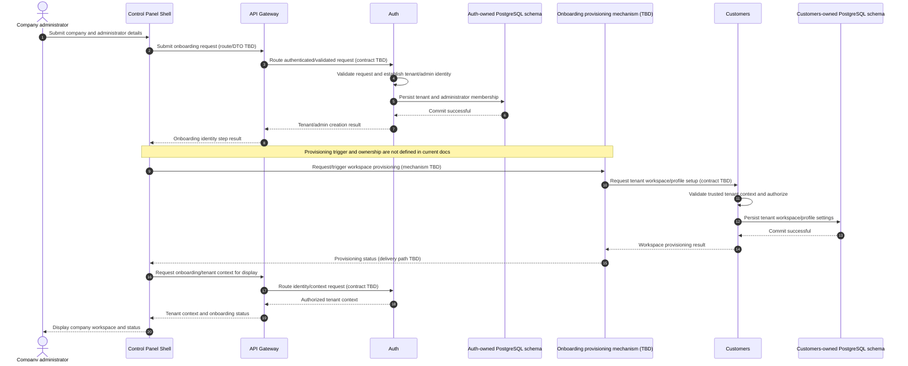

# Company Onboarding

## Purpose and status

This sequence describes the documented logical flow for onboarding a
company/tenant and establishing its administrator identity and customer
workspace. Auth owns tenant membership and administrator identity; Customers
creates the tenant's customer workspace/profile settings. The Control Panel
Shell calls the API Gateway only, and each service owns its data.

The current documentation does not define company-registration routes,
request/response DTOs, the onboarding orchestrator, or the cross-service
provisioning contract between Auth and Customers. The sequence below shows
the required order and boundaries, not an approved endpoint or event design.
The workflow owner and its failure/retry semantics must be decided before
implementation.

## Logical sequence

The `Onboarding provisioning mechanism` participant is a placeholder, not a
defined Daedalus service. It makes explicit that the documentation specifies
Auth and Customers responsibilities but does not say whether provisioning is
initiated by a Shell-driven sequence of Gateway calls, a backend workflow, or
a versioned event. Do not implement this participant or the illustrative
messages as contracts without resolving that decision.

## Trust and service boundaries

- The Gateway is the only external entry point. The Shell does not call Auth
  or Customers directly, access PostgreSQL, or subscribe to Service Bus.
- Auth is authoritative for user identity and tenant membership. The
  Gateway validates JWTs and propagates trusted identity, tenant context,
  and `correlationId`; a browser-supplied tenant identifier alone is never
  trusted.
- Customers independently validates trusted tenant context and authorizes
  creation of its workspace data. It writes only to its own schema.
- Tenant-owned persistence uses `tenant_id`; API and event contracts use
  `tenantId`. Services do not read or write each other's tables.
- Any cross-service provisioning contract must use documented APIs or a
  versioned event. If asynchronous, consumers must be idempotent, process
  only after durable message receipt, and follow the documented retry and
  dead-letter behavior.
- The Shell displays service-backed status through Gateway responses. A
  client-side success state does not imply that provisioning completed.

## Failure, retry, and partial provisioning

The service contracts must define validation, authentication, authorization,
conflict, and dependency errors using the canonical Gateway envelope and a
`correlationId`. Errors must not leak credentials, tokens, SQL, or
cross-tenant resource existence.

Auth persistence may succeed before Customers workspace provisioning fails.
The system must not report full onboarding as complete until both required
steps have succeeded. Before implementation, define how that partial state is
represented, how an authorized retry resumes or safely repeats provisioning,
and how duplicate tenant/workspace creation is prevented. Use idempotency for
retryable commands and bounded retries for transient failures; do not
silently create duplicate tenants or profiles.

The current documentation does not specify compensation or rollback behavior.
Do not assume that deleting an Auth tenant/member is safe when Customer
workspace creation fails. Define recovery, operator visibility, and any
compensation rules with the owning services.

## Optional integration setup

Integration setup is a separate, optional step after tenant onboarding. An
authorized tenant administrator submits credentials through the Gateway to
the service that owns the integration. That service stores secret values in
Azure Key Vault, persists only the Key Vault reference and approved
non-secret metadata in its own schema, and returns safe status without
secret material. The base onboarding flow does not create integrations or
share provider credentials.

## Decisions required before implementation

- Assign ownership of the end-to-end onboarding workflow and specify how
  Auth provisioning triggers Customers workspace creation.
- Define the versioned Gateway routes and Auth/Customers request and response
  DTOs, including administrator authentication/session establishment.
- Define trusted tenant-context propagation and authorization for each
  provisioning operation.
- Decide whether provisioning is synchronous or asynchronous; if
  asynchronous, specify the versioned event/command, delivery, idempotency,
  retry, and dead-letter contracts.
- Define pending, complete, and failed onboarding status, partial-state
  recovery, duplicate handling, and any safe compensation behavior.
- Define audit fields and correlation behavior for tenant creation,
  administrator membership, workspace initialization, and operator recovery.