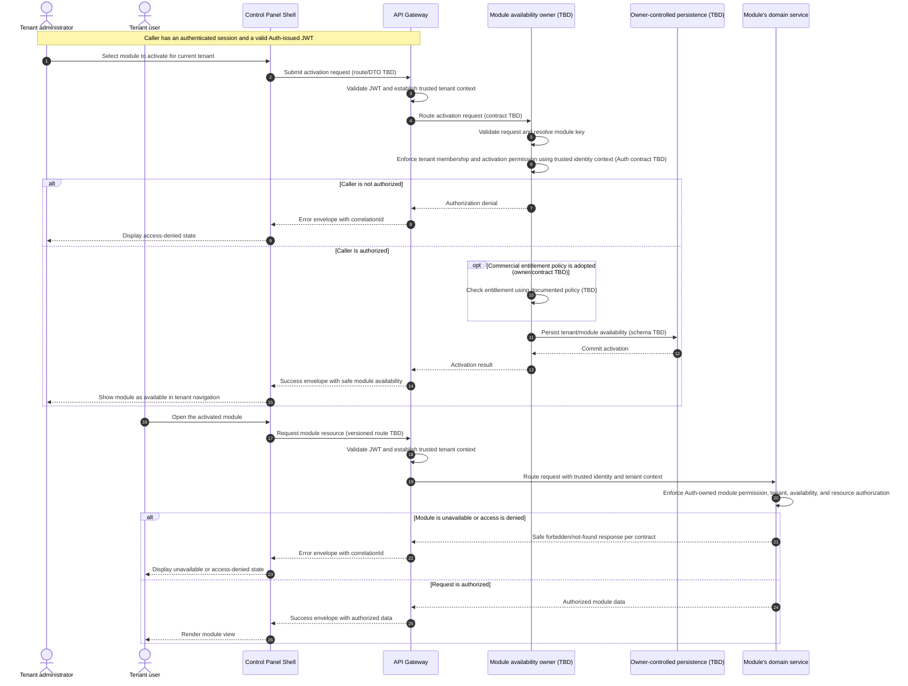

# Module Activation

## Purpose and status

This sequence covers enabling a product module for a tenant and a later
request to use that module. A module is a product-facing capability grouping,
not necessarily a deployable service. The Shell presents module navigation;
backend services own domain behavior and data.

Current documentation does not assign ownership of the module catalog or
tenant module assignments, define an activation API, or establish a module
schema. Activation is therefore shown as a logical operation handled by an
owner to be determined (TBD), not as an existing Daedalus service or approved
contract. Plan-based entitlement is also unresolved and is not assumed.

## Logical sequence

The named `Module availability owner` and `AvailabilityStore` are placeholders
for an ownership decision, not deployed components or established contracts.
The sequence does not prescribe how Auth-owned permissions are represented in
trusted identity context or otherwise made available to the owner; that
behavior must follow the Auth/Gateway contract. Likewise, the entitlement
check applies only if a billing entitlement model is explicitly adopted.

## Activation and access rules

- **Availability** answers whether the product offers a module to a tenant.
  It does not grant an individual permission to use its resources.
- **Authorization** is evaluated for the current identity and trusted tenant
  context. Auth owns roles and permissions; the service that owns each
  resource independently enforces tenant and resource authorization.
- **Feature toggles** control runtime capability behavior or rollout. They
  are separate from tenant module availability and are not authorization.
- **Module settings** configure an available capability; they are not the
  module assignment or an access grant.
- **Billing/entitlement** may constrain availability only after an
  authoritative owner and contract are documented. Do not infer availability
  from a plan label, payment, invoice status, or subscription.
- Hiding a navigation item is presentation behavior. Direct URLs and API
  requests receive the same backend checks.

## Trust and data boundaries

- The Shell calls the API Gateway only. It must not read module/tenant tables
  or call private services directly.
- The Gateway validates the JWT and establishes trusted `tenantId` context.
  A tenant identifier supplied by the browser is not authoritative.
- The module-availability owner, once assigned, writes only its own
  persistence. Other services obtain module metadata through documented
  APIs or versioned events, not cross-schema joins.
- Tenant-scoped persistence uses `tenant_id`; API and event contracts use
  `tenantId`. Assignment uniqueness, concurrency, lifecycle, and deletion
  rules must be specified by the owner.
- Domain services continue to own their records and independently authorize
  access, even when the Gateway has validated the JWT or the module is
  marked available.
- Responses expose only safe availability and authorized view data. Do not
  reveal another tenant's assignments or resource existence.

## Failure and recovery

The owning contracts must specify validation, authorization, unknown-module,
conflict, entitlement, and dependency-failure behavior using the canonical
Gateway envelope and `correlationId`. An unavailable or ambiguous response
must not be treated as a successful activation. Retry behavior must be
bounded and idempotent where supported; concurrent activation requests must
not create duplicate assignments.

If activation persistence succeeds but the Shell fails to receive the
response, the Shell must refresh availability through the Gateway instead of
assuming either success or failure. Exact status states, cache invalidation,
consistency, and recovery behavior are not defined by current documentation.

## Decisions required before implementation

- Assign ownership of the module catalog, tenant availability, and activation
  lifecycle, and decide whether these require persisted assignments.
- Define stable module keys, assignment states, tenant scope, uniqueness,
  concurrency, removal, and audit requirements.
- Define Gateway routes, request/response DTOs, authorization permissions,
  safe errors, versioning, and idempotency behavior.
- Specify how the activation owner receives trusted tenant context and
  validates the administrator's permission with Auth.
- Decide whether tenant plan or subscription entitlements constrain
  availability and, if so, identify their source of truth and contract.
- Define how the Shell discovers and refreshes availability, including
  caching and invalidation behavior.
- Define how each domain service checks module availability, module-level
  permissions, tenant scope, and resource authorization on actual requests.
- Keep feature-toggle evaluation and module settings as separate contracts
  with their own owners.