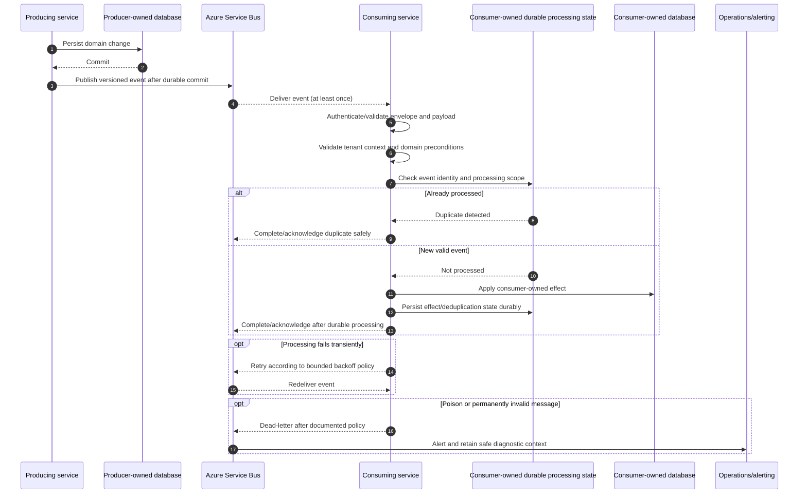

# Event Consumers

## Purpose and status

Azure Service Bus is the default asynchronous messaging technology in
Daedalus. Consumers process commands and domain events without reading or
writing the producer's database tables. This document describes the
consumer-side lifecycle and responsibilities; it does not define concrete
queue or subscription names, message filters, event payload schemas, or
service-specific retry limits.

Event consumers run in backend services. The Control Panel Shell does not
subscribe to Service Bus or treat event payloads as a UI contract. It reads
current domain state through documented API Gateway endpoints.

## Documented consumer responsibilities

| Message/event | Consumer | Required behavior in current docs |
|---|---|---|
| `BookingCreated` | Scheduling | Consume idempotently, check tenant-scoped availability, persist the assignment/result, and publish the resulting fact after persistence. |
| `BookingCreated` and scheduling assignment facts | Notifications | Use documented booking/assignment facts to send relevant confirmations or messages; notification state remains Notifications-owned. |
| Scheduling assignment fact | Jobs | Create the operational job from the documented assignment information; exact event name and payload are not defined. |
| `JobCompleted` | Payments | Consume idempotently and create or update the relevant payment intent using Payments-owned state and provider integration. |
| Booking, assignment, completion, and payment outcome facts | Notifications | Deliver relevant messages and persist Notifications-owned delivery attempts/status. Exact subscriptions and payloads are not defined. |
| `PaymentSucceeded` / `PaymentFailed` | Notifications | Process the established payment outcome and notify as appropriate. The Shell reads current status through APIs. |

This is not a complete subscription catalog. The producer owns the event
contract and remains authoritative for its domain records. Consumers use
only documented APIs or versioned event facts for cross-service data; they
must not join or query another service's schema.

## Processing lifecycle

The inbox and consumer effect must be coordinated so a crash or redelivery
cannot cause a duplicate business action. Exact transaction and storage
implementation is owned by each consumer. The diagram's `Inbox` represents
that logical responsibility and does not mandate a table name or schema.

## Consumer responsibilities

Before applying an event, the consumer:

1. Authenticates the message using the documented Entra identity and
   Service Bus queue/topic permissions.
2. Validates the common envelope and the producer-owned event schema,
   including the supported event version.
3. Confirms the expected producer, event type, and tenant scope. A
   `tenantId` in a message is context, not proof that the consumer may access
   another service's records.
4. Validates domain preconditions using the message's documented facts and,
   when required, a documented API owned by the source service.
5. Checks duplicate-processing state using the documented event identity
   and consumer scope.
6. Applies only effects and database writes owned by the consuming service,
   scoped to the validated tenant where applicable.
7. Records safe logs, metrics, traces, and the propagated `correlationId`.
8. Acknowledges only after all required processing and deduplication state
   are durable.

Consumers must not treat a message as trusted merely because it arrived on
Service Bus. Missing or invalid required context must not cause a fallback
to a default tenant or broaden access.

## Idempotency and durable processing

Service Bus delivery is at least once, so consumers must be safe under
duplicate delivery. Use `eventId` together with a documented consumer or
operation scope to determine whether the event's effect has already been
applied. The exact uniqueness and retention policy for deduplication state
is not specified and must be defined by the consumer.

Persist the consumer effect and its deduplication record atomically where
the storage technology permits. If atomic persistence is not available,
define a recoverable processing state machine that cannot acknowledge before
the effect is durable and can safely resume after a crash. An acknowledgement
must not be the only record that processing succeeded.

Consumers should publish any resulting domain events only after their own
state is durably persisted, following the documented outbox/inbox pattern
where applicable. A consumer does not publish on behalf of the original
producer.

## Retry, dead-letter, and replay

- Retry transient failures with bounded backoff. Do not retry indefinitely.
- Classify permanent validation, unsupported-version, authorization, and
  domain errors according to the consumer's documented policy; poison
  messages are dead-lettered and alerted.
- Do not acknowledge work that has not completed durably. Do not dead-letter
  recoverable transient failures before the retry policy is exhausted.
- Include safe diagnostic information and `correlationId` in operational
  telemetry. Do not copy tokens, credentials, secret values, or unnecessarily
  sensitive payload data into logs or dead-letter descriptions.
- Define who may inspect and replay dead-letter messages, how corrected
  messages are represented, and how replay preserves validation,
  tenant-isolation, and idempotency guarantees.
- Do not assume global ordering. Ordering is guaranteed only within the
  Service Bus session or partition strategy selected for the flow. A
  consumer that requires ordering must document its ordering key and
  behavior for delayed or out-of-order messages.

Exact retry counts, delays, TTLs, lock-renewal behavior, dead-letter
retention, alert thresholds, and replay procedures are not established by
current docs. Each consumer's operational contract must define them.

## Tenant, ownership, and data protection

- Event envelopes use `tenantId`; tenant-scoped PostgreSQL records use
  `tenant_id`.
- Validate tenant context and apply it to every consumer read/write of
  tenant-owned data. A consumer must not trust tenant information solely
  because it appears in an event payload.
- Each service writes only its own schema. Cross-service state is resolved
  through documented APIs or producer-owned event facts, never direct
  cross-schema joins.
- Minimize payload data to the documented consumer need. Avoid copying
  complete rows, API response envelopes, or raw provider payloads into
  messages.
- Never publish credentials, tokens, secret values, or Key Vault secret
  contents. A Key Vault reference does not authorize secret access; the
  owning service retrieves needed values using its own managed identity and
  least-privilege permissions.
- Redact sensitive data in structured logs, metrics, traces, exception
  details, and dead-letter diagnostics.
- `correlationId` is propagated for observability, not authorization or
  deduplication. Preserve it through any resulting events and downstream
  work.

## Event version and subscription behavior

Event contracts are versioned and backward compatible, but the current docs
do not say whether version is encoded in Service Bus metadata, `eventType`,
or an envelope field. Producers and consumers must agree on that
representation and compatibility window before publishing. Consumers must
not interpret an unsupported version as a known schema; quarantine or
dead-letter it according to the documented policy.

The current docs also do not specify topic names, subscription names and
filters, queue names, session IDs, or which optional consumers receive each
event. Define these per flow, with least-privilege access and explicit
ownership. Use queues for commands/work distribution and topics/subscriptions
for domain events.

## Operational visibility

Use structured logs, metrics, and traces to observe message receipt,
validation, processing duration, retries, duplicate detection, dead-letter
rates, and completion. Propagate `eventId`, `eventType`, `sourceService`,
`tenantId` where applicable, and `correlationId` subject to data-handling
rules. Alerts and operator views must avoid exposing another tenant's
resource details or sensitive payload contents.

The Shell does not subscribe to events to refresh user-facing state. It
observes asynchronous progress through owner-provided API responses and
refreshes through the Gateway.

## Consumer contract checklist

Before enabling a consumer, document:

- Event type, supported schema versions, producer identity, and consumer
  ownership.
- Required and optional payload fields, tenant scope, data minimization, and
  source-of-truth/API lookup behavior.
- Queue/topic/subscription, filters, permissions, and any session/partition
  ordering requirements.
- Validation and authorization behavior, including missing, malformed, or
  mismatched tenant context.
- Idempotency key/scope, durable effect and acknowledgement order, and
  duplicate-state retention.
- Transient/permanent error classification, bounded retries, dead-letter,
  alerting, replay, and operator recovery.
- Resulting events and outbox/inbox behavior, if the consumer publishes
  follow-on facts.
- `correlationId` propagation, monitoring, redaction, and sensitive-data
  handling.

Until these contracts are agreed, use the documented flows only as
architectural guidance; do not infer a production consumer implementation or
subscription from an event name alone.