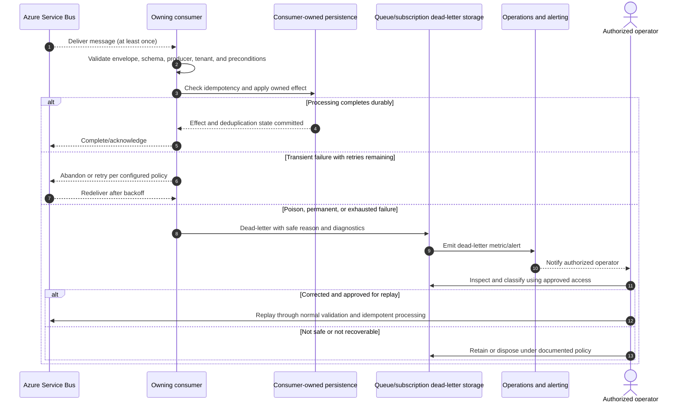

# Dead-Letter Strategy

## Purpose and status

Azure Service Bus is Daedalus's default asynchronous messaging technology.
Messages that cannot be processed successfully after the applicable retry
policy are dead-lettered for diagnosis and controlled recovery rather than
retried indefinitely or silently discarded.

The current `/docs` architecture establishes bounded retries, dead-lettering
and alerting for poison messages, at-least-once delivery, idempotent
consumers, and durable processing before acknowledgement. It does not
specify queue or subscription names, retry counts/delays, message TTL,
dead-letter retention, alert thresholds, or replay tooling. Those operational
values and procedures must be set by the owning service and platform
operators; this document does not invent them.

## Dead-letter decision

Classify the failure before retrying or dead-lettering:

| Failure category | Handling |
|---|---|
| Transient dependency or infrastructure failure | Retry using the consumer's bounded backoff policy. Dead-letter only after the retry policy is exhausted or the message can no longer be processed safely. |
| Invalid envelope or malformed payload | Do not apply business effects. Dead-letter with a safe reason and diagnostic context after validation establishes that the message is not processable. |
| Unsupported event type or schema version | Do not interpret it as a known contract. Quarantine or dead-letter according to the compatibility and recovery policy. |
| Permanent domain validation failure | Do not retry indefinitely. Dead-letter or route for an explicitly documented correction workflow. |
| Authorization or tenant-context failure | Fail closed. Do not broaden access or retry with another tenant context. Record safe diagnostics and dead-letter or alert according to the consumer's security policy. |
| Duplicate already processed event | Do not apply the effect again. Complete/acknowledge the duplicate after confirming durable deduplication state; do not dead-letter as a processing failure. |
| Ambiguous external side effect | Do not repeat a non-idempotent operation blindly. Reconcile the outcome with the provider or owner-defined recovery process before retrying or dead-lettering. |

The exact point at which a failed delivery is dead-lettered depends on the
failure type and consumer policy. A permanent validation error need not
consume a transient retry budget, while transient failures should receive
only the configured bounded retries. Consumers must not acknowledge a
message whose required effect has not been durably processed.

## Failure processing flow

The diagram describes logical behavior, not exact Service Bus SDK calls.
Replay must use a documented mechanism and preserve the original event
identity or otherwise retain a traceable relationship to it. Do not bypass
consumer validation, tenant authorization, deduplication, or audit controls
when replaying.

## Dead-letter diagnostic data

Store only the minimum safe context needed to identify and investigate the
failure:

- Original `eventId`, `eventType`, producer identity, supported version
  indicator where available, `correlationId`, and `tenantId` when applicable.
- Consumer identity and subscription/queue context.
- Failure category, safe error code/reason, attempt or delivery context where
  available, and the time of failure.
- A protected reference to the original message when full payload access is
  needed and permitted by policy.

Do not copy secrets, access tokens, credentials, Key Vault secret contents,
full provider payloads, or unnecessary personal/financial data into
dead-letter descriptions, logs, dashboards, or alerts. The original message
may itself contain sensitive business data; restrict access, protect it at
rest and in transit, redact diagnostic views, and apply an explicit
retention/deletion policy.

`tenantId` and `correlationId` help scope investigation and tracing but are
not authorization credentials. Operator tools must enforce least privilege
and must not disclose another tenant's data to an unauthorized operator.

## Retry and dead-letter configuration

Each consumer's operational contract must define:

- Which error categories are retryable, and which are permanent.
- Maximum delivery/retry attempts and the backoff schedule.
- Behavior for message expiration, lock loss, poison messages, and exhausted
  retries.
- Dead-letter retention, access controls, encryption, monitoring, and
  deletion policy.
- Alert thresholds, escalation owner, response expectations, and dashboards.
- Replay eligibility, authorization, approval requirements, audit trail, and
  rate limits.
- Idempotency/deduplication key and retention sufficient to cover retries and
  approved replay windows.

Current documentation does not provide numeric defaults for these settings.
Do not assume Azure Service Bus defaults are the approved application
policy. Set values based on the consumer's latency, dependency, ordering,
and recovery requirements and record them in its service/runbook contract.

## Replay and recovery controls

Before replay, an authorized operator or controlled recovery process must:

1. Identify the owning producer and consumer, message type/version, tenant
   scope, and failure category.
2. Determine whether the underlying cause is corrected and whether the
   original operation already caused an external or durable side effect.
3. Confirm that replay is safe under the consumer's idempotency and
   deduplication policy. For non-idempotent provider actions, reconcile the
   provider outcome first.
4. Preserve or record the original `eventId`, `correlationId`, and a
   traceable replay reference; do not rewrite business facts silently.
5. Submit the message through the normal consumer validation and
   authorization path. Do not write directly to another service's database
   or mark the original delivery successful outside the owning consumer.
6. Audit the operator, reason, approval where required, target message, and
   replay outcome without recording sensitive payload contents.

If a payload requires correction, the owning producer must define how the
corrected event relates to the original, including event identity,
versioning, and audit semantics. Operators must not manually mutate event
payloads in ways that change the producer-owned fact without an approved
correction workflow.

## Ownership and security

- The consuming service owns classification of processing failures and the
  business recovery rules for its consumer.
- Platform operators own Service Bus infrastructure, access controls,
  monitoring, and the approved operational replay mechanism; they do not
  take ownership of domain data or bypass the consumer.
- Authenticate service-to-service messaging with Entra identity and
  per-queue/topic authorization, TLS, and least privilege.
- Consumers validate message envelope, event schema, producer identity,
  tenant context, and domain preconditions before processing or replay.
- Tenant-scoped operations use the validated `tenantId` from trusted
  processing context and persist `tenant_id`. Missing, malformed, or
  mismatched tenant context fails closed.
- Redact sensitive data in exceptions, telemetry, dead-letter metadata, and
  operator interfaces. Never publish or expose secret values.
- Preserve `correlationId` across processing, retries, dead-letter
  investigation, and any follow-on events. Correlation does not replace
  authorization or idempotency.

## Observability and review

Monitor dead-letter count and rate by consumer, event type, safe error
category, and time window. Alert on sustained or unusual increases and on
poison-message patterns, without exposing message contents or cross-tenant
details. Track delivery attempts, retry outcomes, processing duration,
dead-letter age, replay outcomes, and unresolved incidents with
`correlationId` and `eventId` where safe.

Review dead-letter causes with the producing and consuming service owners.
Fix the source contract, producer, consumer, or dependency rather than
relying on repeated manual replay. Verify that schema changes remain
backward compatible and that redrive does not create duplicate business
effects.

## Decisions required before production

- Retryable/permanent error taxonomy and per-consumer retry counts/backoff.
- Message TTL, lock/session configuration where applicable, dead-letter
  retention, encryption, and deletion schedule.
- Alert thresholds, escalation and on-call ownership, and incident workflow.
- Operator roles, approval requirements, tooling, audit, and replay rate
  limits.
- Idempotency and deduplication retention that covers both normal redelivery
  and authorized replay.
- Payload redaction, protected access to original messages, and tenant-aware
  operator visibility.
- Handling for unsupported event versions, invalid tenant context, and
  ambiguous external provider outcomes.

Until these settings and procedures are assigned, dead-letter processing
must follow the general documented rules—bounded retries, alert poison
messages, preserve idempotency and tenant isolation, and redact sensitive
data—without assuming unspecified numeric thresholds or replay permissions.