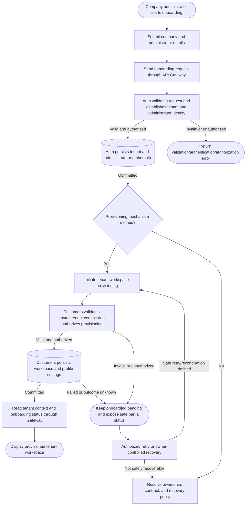

# Tenant Onboarding

## Purpose and status

Tenant onboarding establishes a tenant boundary, associates an initial
administrator identity with that tenant, and provisions the tenant's
customer workspace. Auth owns tenant membership and administrator identity;
Customers owns the customer workspace/profile settings. The Shell is
presentation-only and uses the API Gateway; each service writes only its own
data.

The current documentation does not define company-registration routes,
request/response DTOs, an onboarding orchestrator, or the provisioning
contract between Auth and Customers. This flow reflects the documented
responsibilities and required sequence without establishing an endpoint,
event, or orchestration design.

## Business flow

The provisioning decision is intentionally explicit: the current docs do
not say whether the Shell makes sequential Gateway calls, a backend workflow
coordinates the steps, or Auth publishes a versioned event consumed by
Customers. The `Provisioning mechanism defined?` decision and recovery
branch must be resolved before implementing the flow.

## Step responsibilities

1. **Collect onboarding input.** The company administrator submits company
   and administrator details in the Shell. The request contract and
   validation requirements are not defined here.
2. **Route through the Gateway.** The Shell calls the public API Gateway.
   It never calls Auth or Customers directly, accesses PostgreSQL, or
   subscribes to Service Bus.
3. **Establish identity and tenant membership.** Auth validates the
   onboarding operation and, when authorized, creates the tenant membership
   and administrator identity in Auth-owned persistence. A browser-provided
   tenant identifier is not trusted as authorization context.
4. **Provision the customer workspace.** Through a provisioning contract
   still to be defined, Customers validates trusted tenant context and
   authorization and writes the workspace/profile settings to its own
   persistence.
5. **Present status.** The Shell reads authorized tenant context and
   onboarding status through Gateway APIs. A client-side success screen or
   an Auth-only success does not establish that the Customers workspace has
   been provisioned.

## Data ownership and trust

- Auth owns identity, tenant memberships, roles, permissions, and
  authentication metadata. Customers owns customer workspace/profile data.
- Tenant-scoped persistence uses `tenant_id`; API and event contracts use
  `tenantId`. Trusted context must be established by the authenticated
  backend flow, not accepted from arbitrary client input.
- Auth and Customers each write only their own schema. Cross-service
  provisioning uses a documented API or versioned event; it must not use a
  cross-schema join, shared mutable table, or direct database write.
- The target service independently validates tenant context and authorizes
  each operation. Gateway JWT validation does not replace service-side
  authorization.
- Integration setup is optional and separate from base tenant onboarding.
  If added later, the owning integration service stores secret values in
  Key Vault and persists only approved non-secret metadata and a secret
  reference in its own schema.

## Failure, retry, and recovery

Auth may commit the tenant and administrator membership before Customers
workspace provisioning succeeds. The workflow must therefore distinguish
partial or pending onboarding from complete onboarding and must not report
the whole flow complete until all required provisioning steps are confirmed.

- Use bounded retries only for classified transient failures and only when
  the operation is safe or idempotent.
- Prevent duplicate tenant, membership, or workspace creation using
  owner-defined idempotency and uniqueness behavior.
- If a request times out or its response is lost, treat the outcome as
  ambiguous. Reconcile through the owning service before retrying or
  compensating.
- Do not assume deleting an Auth tenant or membership is a safe rollback
  when Customers provisioning fails. Compensation, if appropriate, must be
  an explicitly defined owner-controlled operation.
- Return errors and status through the canonical Gateway envelope with a
  `correlationId`. Do not expose credentials, tokens, SQL, or
  cross-tenant resource existence.
- If automated recovery is not safe or its contract is not established,
  preserve a pending/partial state for authorized operator resolution
  rather than silently treating onboarding as successful or discarding
  committed state.

## Decisions required before implementation

- Assign end-to-end onboarding workflow ownership and decide how Auth
  provisioning triggers Customers workspace creation.
- Define versioned Gateway routes and Auth/Customers DTOs, including
  administrator authentication/session establishment and validation.
- Define how trusted tenant context and authorization are propagated and
  checked by each service.
- Choose synchronous or asynchronous provisioning and document the
  associated API, command, or event contract.
- Define pending, complete, and failed onboarding status; idempotency,
  duplicate handling, retry/dead-letter behavior, and partial-state
  recovery.
- Decide whether any compensation is safe and specify the owner-controlled
  action; do not assume cross-service rollback.
- Define audit data, correlation propagation, safe status visibility, and
  authorized operator recovery.