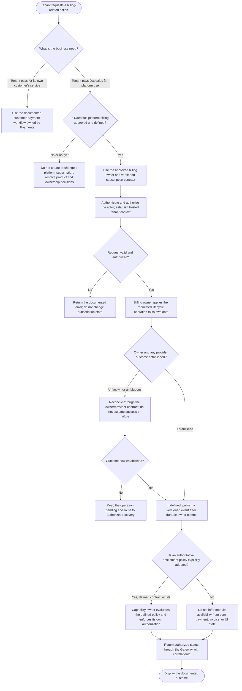

# Platform Subscription Lifecycle

## Purpose and current status

This flow concerns a possible **Daedalus-to-tenant platform subscription**.
It is not the customer payment workflow a tenant operates for its own
customers. The documented Payments service owns payment intents,
transactions, refunds, reconciliation, and provider references; that
ownership does not establish a platform subscription service.

The current `/docs` do not define a platform billing owner, subscription
schema, plans or prices, subscription API, lifecycle states, billing
provider, invoices, usage metering, or entitlement behavior. Accordingly,
the flow below is a decision framework for a future approved capability,
not an implemented lifecycle or contract. Do not treat the presence of
subscription-like model concepts elsewhere in the repository as an
authoritative `/docs` ownership decision.

## Business flow and decision gates

The branches for customer payments and platform billing are distinct
business domains. The current documentation does not define the customer
payment lifecycle in this file, nor does it provide a platform subscription
contract; do not infer one from this diagram.

## Future lifecycle responsibilities

If platform subscriptions are approved, the owner and business stakeholders
must define each lifecycle action and its allowed transitions before
implementation. Candidate actions requiring explicit policy include:

- Establishing a billing relationship and associating an approved offer
  with a tenant.
- Starting service, changing an offer, or changing billing terms.
- Renewing, invoicing, collecting payment, and reconciling provider
  outcomes, if those behaviors are in scope.
- Pausing, suspending, resuming, cancelling, or ending a subscription, if
  those behaviors are supported.
- Handling failed, delayed, disputed, or reversed payment outcomes and
  deciding whether they affect platform access.

These are questions to resolve, not states or behaviors currently
established by `/docs`. Do not assume one subscription per tenant,
automatic renewal, proration, immediate cancellation, grace periods, or
that a provider outcome changes application access.

## Ownership and access boundaries

- Assign a platform-billing owner and source of truth for billing accounts,
  offers/prices, subscriptions, invoices, usage, provider references, and
  any entitlements before implementation.
- Keep tenant subscription records, if adopted, within the assigned
  owner's persistence boundary. Other services must use documented APIs or
  versioned events; no direct cross-schema reads or writes are allowed.
- The Control Panel Shell presents billing status using Gateway APIs. It
  does not create authoritative subscription state, connect directly to
  services or databases, or treat local display state as proof of a change.
- Auth roles and permissions determine who may perform an operation.
  Billing status, payment success, plan name, and visible navigation do
  not grant identity or permissions.
- Tenant-scoped persistence uses `tenant_id`; API/event contracts use
  `tenantId`. Establish tenant scope from validated identity and enforce
  tenant and resource authorization in the owning service.
- If an external provider is used, define provider ownership,
  authentication, idempotency, callback validation, timeout, and
  reconciliation behavior. Secret values remain in Azure Key Vault; never
  persist or return them as subscription data.

## Entitlements and module availability

The current docs leave module catalog and tenant module availability
ownership unassigned and explicitly do not assume plan-based entitlement.
If commercial entitlements are later adopted:

- Define an authoritative entitlement owner and a versioned contract.
- Specify how the capability-owning service evaluates that contract and
  applies access policy on actual requests.
- Keep entitlements distinct from Auth permissions, module availability,
  feature toggles, and module settings.
- Do not infer access from a plan label, payment result, invoice status,
  subscription state, or Shell visibility without the explicit policy.

Until that policy is approved, this flow must not activate or deactivate
product modules based on subscription or payment information.

## Failure, retry, and recovery

- Validate and authorize each operation before changing owner-controlled
  state. Failed validation or authorization must not alter subscription
  state.
- Use bounded retries only for classified transient failures and only when
  the operation is safe or its documented idempotency contract prevents
  duplicate effects.
- A timeout, disconnected client, or missing provider callback leaves the
  outcome potentially ambiguous. Reconcile through the owning service or
  provider before retrying, cancelling, or compensating.
- Do not assume payment or subscription changes can be rolled back. Any
  cancellation, refund, adjustment, or compensation must be an
  owner-controlled, documented operation.
- Persist owner-local changes durably before publishing any documented
  event. Consumers are idempotent and write only their own effects.
- Report pending, failed, or partial outcomes only as defined by the
  approved API contract. Do not return success-shaped defaults or claim
  that a charge, invoice, subscription change, or entitlement update
  succeeded before the owner establishes the outcome.
- Carry `correlationId` through requests, events, provider operations, and
  safe audit/telemetry records. Do not expose credentials, tokens, raw
  provider payloads, or another tenant's billing information.

## Decisions required before implementation

1. Is platform subscription billing in scope, separate from customer
   payments, or is no subscription product required?
2. Which service owns platform billing and the authoritative subscription
   record? Is a separate service required?
3. What offers, prices, currencies, billing periods, taxes, proration,
   invoicing, usage, renewal, and payment terms are supported?
4. What lifecycle states and transitions are allowed, and what are the
   semantics for cancellation, suspension, failed payment, grace periods,
   and provider reconciliation?
5. What Gateway routes, DTOs, permissions, idempotency scopes, error
   mappings, audit fields, and event contracts are required?
6. Does billing control any entitlement or module availability? If so,
   which owner evaluates and enforces the explicit policy?
7. What are the retry, timeout, compensation, partial-failure, operator
   recovery, data-retention, and tenant-isolation requirements?

Until these decisions are approved and added to the authoritative
architecture and data-model documentation, treat platform subscription
records and lifecycle behavior as undefined. Do not infer a subscription
schema or platform billing responsibility from the Payments service.