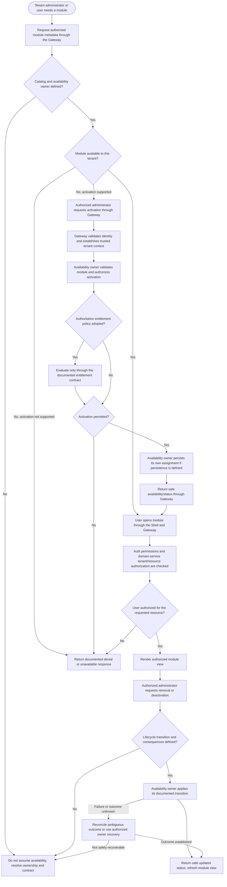

# Module Lifecycle

## Purpose and status

A module is a product-facing capability grouping in the Control Panel, such
as Customers, Bookings, Quotes, Scheduling, Jobs, Payments, or Notifications.
It is not necessarily a deployable service. The Shell presents module
navigation; domain services own business behavior and data.

The current `/docs` do not assign ownership of the module catalog or tenant
module availability, define an activation/deactivation API, or establish a
module schema or lifecycle states. This flow shows the logical decisions
that a future approved lifecycle must address. It does not create an
implementation contract or assume persistent tenant-module assignments.

## Lifecycle flow

Activation, deactivation, and lifecycle transition names in this flow are
conceptual. The exact actors, supported transitions, persistence behavior,
and recovery contract must be defined by the assigned owner before
implementation.

## Lifecycle responsibilities

If module catalog and tenant availability are adopted:

1. **Discover.** The Shell requests module metadata and availability through
   documented Gateway APIs. It does not read module tables or call private
   services. Metadata and navigation visibility are presentation data, not
   authorization.
2. **Resolve availability.** A designated owner determines whether a
   module is offered to a tenant. The current docs do not identify this
   owner or mandate tenant assignments.
3. **Activate, if supported.** An authorized administrator requests the
   change through the Gateway. The owner validates the module key and
   trusted tenant context, checks the required permission, evaluates an
   entitlement only if an authoritative policy is defined, and writes only
   its own persistence.
4. **Use the module.** Auth permissions and the domain service's tenant and
   resource authorization are checked for each request. Availability alone
   does not authorize an individual or grant access to every resource.
5. **Deactivate or remove, if supported.** The owner applies only a
   documented transition. Effects on existing domain data, in-flight work,
   links, and historical records must be specified; do not assume that
   deactivation deletes domain data or cancels work.
6. **Refresh status.** After a timeout, lost response, identity/tenant
   change, or lifecycle operation, the Shell refreshes status through the
   Gateway rather than treating client state as authoritative.

## Distinct concepts and enforcement

- **Module availability** describes whether a product capability is offered
  to a tenant, if that concept is adopted.
- **Auth roles and permissions** determine whether a particular actor may
  perform an operation. Auth owns role and permission definitions and
  assignments.
- **Domain authorization** remains with each service that owns the requested
  resource; Gateway checks do not replace service-side authorization.
- **Feature toggles** control runtime capability behavior or rollout. They
  are not module availability, entitlements, or authorization.
- **Module settings** configure an available capability and remain separate
  from catalog and availability ownership.
- **Billing entitlements** may constrain module availability only after an
  authoritative owner and contract are defined. Do not infer access from a
  plan label, payment outcome, invoice status, subscription state, or UI
  visibility.

Hiding a navigation item is a presentation choice. Direct URLs and API
requests must receive the same backend authorization checks.

## Data ownership and trust boundaries

- The Shell calls the API Gateway only and owns transient presentation
  state, not authoritative module catalog or tenant assignment data.
- The module availability owner, once assigned, writes only its own
  persistence. Other services obtain module facts through documented APIs
  or versioned events, not cross-schema joins or shared mutable tables.
- Tenant-scoped persistence uses `tenant_id`; API and event contracts use
  `tenantId`. Establish tenant scope from validated identity and trusted
  backend context, not an unchecked browser field.
- Each domain service continues to own and authorize its domain records,
  even when the module is visible or marked available.
- Responses and events expose only safe, authorized availability data. Do
  not disclose another tenant's assignments or resource existence.

## Failure, concurrency, and recovery

- Define validation, authentication, authorization, unknown-module,
  conflict, entitlement, and dependency-failure behavior in the owning
  contract and return the canonical Gateway envelope with `correlationId`.
- If activation or deactivation has an ambiguous outcome, refresh status
  through the Gateway or reconcile with the owner before retrying. A
  timeout does not prove that the owner did not commit.
- Retry only classified transient failures with bounded retries and
  idempotency where supported. Prevent duplicate or conflicting assignment
  changes through owner-defined uniqueness and concurrency behavior.
- Do not silently interpret an unavailable or ambiguous response as
  success, or use stale client-side availability to authorize access.
- Do not directly alter another service's tables, erase domain data, or
  cancel in-flight work as an implicit compensation. Any recovery or
  compensation must be an explicit owner-controlled contract.
- Preserve tenant scope, audit actor/action/outcome, and correlation context
  for lifecycle changes. Do not expose secrets or cross-tenant information.

## Decisions required before implementation

1. Assign ownership and source of truth for the catalog, tenant
   availability, activation/deactivation, and lifecycle.
2. Decide whether availability requires persisted tenant assignments and
   define stable keys, states, uniqueness, concurrency, and deletion rules.
3. Define supported actors, Auth permissions, Gateway routes, DTOs, errors,
   idempotency, and tenant-context propagation.
4. Decide whether billing entitlements affect availability; if so, assign
   the entitlement owner and enforcement contract. Do not assume plan-based
   restrictions.
5. Define effects on existing domain data, in-flight operations, and
   dependent services when a module is deactivated or removed.
6. Specify discovery, cache freshness/invalidation, event contracts, and
   failure/recovery behavior if those mechanisms are used.
7. Keep feature toggles, module settings, billing, and domain data under
   their separately documented ownership boundaries.