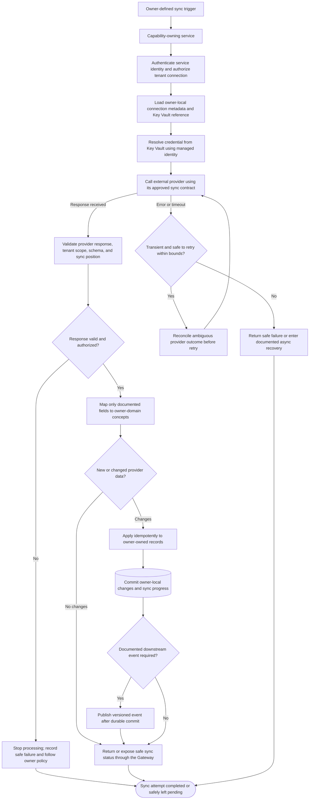

# Integration Sync

## Purpose and status

Integration sync is the owner-controlled exchange of data between an
external provider and a Daedalus capability. The service that owns the
capability owns the provider connection, synchronization behavior, and
resulting domain records. For example, Payments owns its payment-provider
interactions and Notifications owns message delivery. There is no
standalone Integration Service or shared integration-data schema in the
current architecture.

The current `/docs` do not define specific providers, synchronized entities,
directions, schedules, webhook contracts, cursor/checkpoint models, conflict
rules, or sync API routes. This is a logical system flow and contract
checklist, not an implemented sync design. Define each provider integration
with its owning service before implementation; do not infer polling,
webhooks, batch intervals, or data mappings.

## Logical sync flow

The trigger, transport, direction, and status delivery are integration-
specific decisions. The flow does not establish a generic scheduler,
webhook receiver, sync engine, or retry/dead-letter implementation for
provider calls.

## Processing responsibilities

1. **Start under the owning service.** A scheduled task, authorized request,
   validated provider callback, or other trigger may start a sync only when
   that trigger is defined by the owning integration contract. The Shell
   calls the API Gateway only; it does not call providers, private services,
   or Service Bus directly.
2. **Establish trusted context.** The owner authenticates the workload,
   resolves the intended connection, establishes trusted `tenantId`
   context, and authorizes the operation. A tenant identifier or connection
   identifier supplied by a caller or provider is not by itself
   authorization.
3. **Resolve credentials securely.** The owning backend uses its managed
   identity and least-privilege access to resolve credentials from Azure
   Key Vault. PostgreSQL stores only a Key Vault reference and approved
   non-secret metadata. Secret values must not enter browser state, logs,
   events, or API responses.
4. **Exchange and validate data.** The owner follows the provider's
   documented authentication, pagination, rate-limit, schema, and
   continuation/checkpoint contract, if supported. Validate the response
   before applying changes; treat provider payloads as untrusted input.
5. **Apply owner-local changes.** Map only explicitly documented fields.
   Persist changes and any sync checkpoint in the owning service's
   persistence boundary. Do not query or update another service's schema.
6. **Publish downstream facts if required.** If the change must notify
   another service, publish a documented, versioned event only after the
   owner commits durable state. The receiving service validates the event,
   processes it idempotently, and writes only its own effects.
7. **Expose safe status.** The Shell reads documented progress/status
   through the Gateway. Sync payloads, secret material, and internal
   provider errors are not returned.

## Data ownership and synchronization semantics

- The capability-owning service remains authoritative for Daedalus domain
  records. A provider may be authoritative for provider-owned facts; the
  contract must define which system owns each field and how conflicts are
  resolved.
- Never treat a cached provider response, event, or sync checkpoint as
  permission to access or change another service's data.
- Define direction and scope explicitly: which provider objects and
  Daedalus records are read, created, updated, or ignored. Do not assume
  bidirectional sync or that every provider field is imported.
- Define identity matching and duplicate handling before linking external
  records. Use owner-controlled, tenant-scoped opaque references; do not
  rely on names or client-selected tenant context as authorization.
- Specify how deleted, revoked, unavailable, or disconnected provider
  records are represented. Do not infer destructive deletion or cascading
  effects from an absent item in one provider response.
- Define field-level mapping, normalization, validation, ownership,
  timestamp/version interpretation, and conflict policy. Do not overwrite
  newer owner-controlled values with stale provider data without an
  explicit rule.
- If another service needs resulting facts, use documented APIs or
  versioned events. Do not introduce cross-schema joins, shared mutable
  tables, or a generic integration schema.

## Idempotency, progress, and recovery

Provider operations and sync execution may be retried only under the
owning contract. Service timeouts or lost responses can leave an external
side effect ambiguous:

- Apply safe idempotency or deduplication to repeated sync work using
  identifiers and scope defined by the integration contract.
- Persist progress/checkpoints only with documented semantics. Advance a
  checkpoint only after all corresponding owner-local effects are durable;
  otherwise define a replay-safe recovery procedure.
- Reconcile with the provider or owning service before repeating a
  non-idempotent operation whose result is unknown.
- Use bounded timeouts and retries for transient failures. Do not retry
  validation, authentication, authorization, or permanent schema errors as
  though they were transient.
- If an asynchronous consumer cannot process after its retry policy is
  exhausted, use its documented dead-letter and authorized replay policy.
  Replay preserves normal validation, tenant isolation, and idempotency.
- Keep pending, partial, failed, and completed status distinct according to
  the owner-defined contract. Do not report completion when writes or
  required downstream effects remain ambiguous.
- Define recovery for invalid credentials, revoked access, provider
  throttling/outage, malformed data, mapping failures, duplicate records,
  partial batch results, and missed callbacks/checkpoints, as applicable.

## Security and operations

- Auth owns user identity, tenant memberships, roles, and permissions. The
  Gateway validates caller JWTs; the owning service independently
  authorizes connection administration and sync operations.
- Tenant-scoped persistence uses `tenant_id`; API/event contracts use
  `tenantId`. Scope connection lookup, provider operations, records,
  checkpoints, retries, and recovery to the validated tenant.
- Use managed identities and least privilege for Key Vault and Azure
  resources. Do not share credentials across tenants or services unless an
  explicitly reviewed contract requires it.
- If provider callbacks are supported, authenticate and validate them
  according to the provider and owner contract, including replay/duplicate
  handling and tenant/connection association. Do not accept a callback as
  proof of authorization by itself.
- Propagate `correlationId` through Gateway, owner service, provider
  operation, and resulting event where applicable. Log safe status,
  counts, durations, retry outcomes, and error categories; redact secrets
  and sensitive provider payloads.
- Return safe errors through the canonical Gateway envelope. Do not expose
  credentials, raw provider responses, SQL, internal hostnames, or
  cross-tenant resource existence.

## Decisions required before implementation

For each provider integration, document:

1. The capability-owning service, provider, tenant connection lifecycle,
   and source of truth for each synchronized field.
2. Direction, included records, triggering mechanism, cadence or callback
   contract, and whether processing is synchronous or asynchronous.
3. Provider authentication, Key Vault reference/access policy, request and
   response schemas, pagination, rate limits, and version compatibility.
4. Tenant/resource authorization, record matching, field mapping,
   conflict resolution, deletion semantics, and data minimization.
5. Idempotency, checkpoint/progress state, transaction boundary,
   concurrency, duplicate/out-of-order handling, and downstream events.
6. Timeout, retry, circuit-breaker, partial-result, dead-letter, replay,
   reconciliation, and operator recovery behavior.
7. Safe status/API responses, `correlationId`, audit fields, metrics,
   alert thresholds, retention, and redaction rules.

Until these decisions are recorded in the owning service contract, keep sync
behavior provider-specific and unimplemented; do not infer a standalone
Integration Service, generic sync endpoint, polling schedule, or webhook
contract.