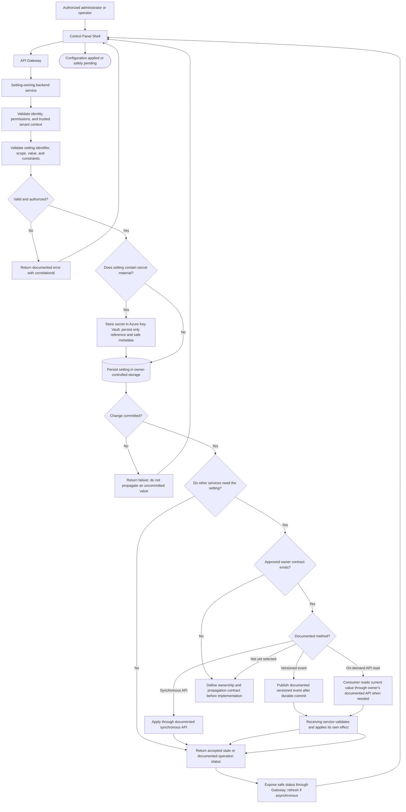

# Configuration Propagation

## Purpose and status

Configuration propagation carries an approved configuration change from its
owning service to the components that need to apply it. The setting's
behavior owner remains authoritative: storing configuration does not make
the Shell or a separate configuration component the owner of domain
behavior.

The current `/docs` do not define a standalone Configuration Service,
`configuration` schema, generic settings route, propagation event, or
whether changes are synchronous or event-driven. This is a logical flow
showing the required boundaries, not an implementation contract. Keep each
setting with its behavior-owning service unless ownership is explicitly
assigned, and document routes, events, scope, and application semantics
before implementation.

## Logical flow

The unresolved branch means propagation cannot be implemented for that
setting until the owner selects and documents an approved contract. An
on-demand read is allowed only through an API documented by the setting
owner; consumers may not access the owner's database directly or infer a
default propagation mechanism.

## Step responsibilities

1. **Submit a change.** An authorized user submits a setting through the
   Shell and API Gateway. The Shell owns only form and transient view state;
   it does not persist settings or make authorization decisions.
2. **Establish trusted context.** The Gateway validates the JWT and
   propagates trusted identity, tenant context, and `correlationId`. The
   target service independently authorizes access to its setting and
   resource. A client-supplied tenant identifier is not authoritative.
3. **Validate and persist.** The owner validates the setting's identifier,
   type, scope, mutability, and constraints. It commits the accepted value
   only to its own persistence boundary. Tenant-scoped PostgreSQL values use
   `tenant_id`; API/event contracts use `tenantId`.
4. **Protect secrets.** Secret values are stored in Azure Key Vault using
   the owning backend's managed identity and least privilege. PostgreSQL
   stores only a Key Vault reference and approved non-sensitive metadata.
   Secret material must not appear in Shell state, API responses, events,
   logs, or source control.
5. **Propagate only when required.** If another component must react, use
   the setting owner's documented API or versioned event after durable
   persistence. The receiving service validates the contract and writes
   only its own effects. No service reads or writes another service's
   tables.
6. **Report status.** A synchronous response reports the accepted result as
   defined by its contract. An asynchronous response reports only its
   documented operation/status state; the Shell refreshes it through the
   Gateway rather than assuming propagation completed.

## Scope, precedence, and effective values

The current settings model does not define a universal scope, inheritance
hierarchy, or precedence algorithm. For each setting, its owner must specify
whether it is a service default, tenant override, or another explicitly
supported scope. If multiple levels apply, define precedence, reset and
missing-value behavior, and the point at which the effective value is
resolved.

Consumers must not combine client caches or invent fallback rules to
calculate effective settings. If another service requires a setting, it
must obtain it from the owner through the documented API/event contract.
Any projection or cache is non-authoritative and must define freshness,
tenant/authorization scope, invalidation, and recovery.

Configuration propagation is distinct from:

- **Module availability:** configuration does not activate a tenant module
  or grant access.
- **Auth permissions:** a setting value does not authorize an actor or
  resource operation.
- **Feature toggles:** settings do not substitute for a toggle's runtime
  rollout or kill-switch policy.
- **Domain state:** configuration storage does not take ownership of the
  behavior or domain records it influences.
- **Integration connections:** provider connection ownership and Key Vault
  references remain with the service that owns the integration unless an
  explicit contract assigns otherwise.

## Consistency, versioning, and failure handling

- The owner defines whether consumers need immediate application or can
  tolerate eventual consistency. Do not promise propagation timing or
  global consistency that the contract does not establish.
- Synchronous propagation uses documented service APIs and bounded
  timeouts/retries. Retry writes only when their idempotency contract makes
  repetition safe.
- Event propagation uses a documented, versioned event published only
  after the owner's durable commit. Consumers validate the producer, event
  type/version, tenant context, and payload; delivery is at least once, so
  consumer effects must be idempotent and durably recorded before
  acknowledgement.
- Define how updates, deletes/resets, duplicate or out-of-order changes,
  concurrent edits, and stale consumer state are handled. Do not assume
  ordering beyond a documented Service Bus session/partition strategy.
- If persistence succeeds but propagation fails, retain the committed
  owner state and report the documented pending/failed status. Retry,
  replay, or reconcile only through the defined contract; do not roll back
  another service's data or return success-shaped defaults.
- A timeout or lost response leaves the outcome ambiguous. Re-read status
  through the owner API before repeating a potentially non-idempotent
  update.
- Propagate `correlationId` and safe actor/tenant/target/outcome audit
  metadata. Redact values that are secret or otherwise sensitive.

## Decisions required before implementation

For each propagated setting, document:

1. The setting's behavior owner, source of truth, and any separate
   configuration-storage owner.
2. Supported scopes, defaults, precedence, validation, reset, mutability,
   and effective-value resolution.
3. Which consumers need the change and why; minimum required fields and
   sensitivity classification.
4. Synchronous API or asynchronous event method, route/schema/version,
   tenant context, authorization, idempotency, and status contract.
5. Consumer application semantics, transaction boundary, consistency,
   ordering, duplicate handling, and cache/projection invalidation.
6. Timeout, retry, dead-letter/replay, partial failure, reconciliation,
   audit, and operator recovery behavior.
7. Key Vault ownership and reference handling for secret-backed settings.

Until these decisions are recorded in the owning service contracts, do not
implement a generic configuration propagation channel, central
`module_settings` store, direct database access, or undocumented event.