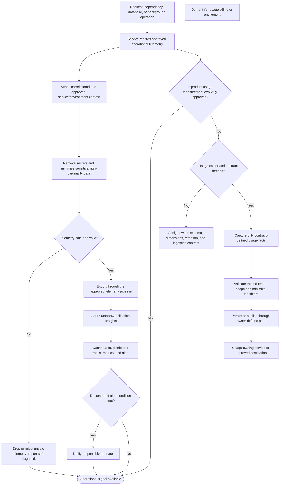

# Metrics Ingestion

## Purpose and status

Daedalus services emit operational telemetry, including request and
dependency metrics, queue depth and age, database timing, and distributed
traces. Azure Monitor/Application Insights is the documented platform for
logs, metrics, traces, and alerts.

Operational telemetry is distinct from product usage measurement or
commercial metering. The current `/docs` do not assign usage metric
ownership, define a usage-metric schema or ingestion API/event, specify
metric names and dimensions, or establish retention and aggregation rules.
Platform billing and usage billing are also unassigned. This flow therefore
documents established operational telemetry at a logical level and marks
product usage measurement as conditional on an approved owner and contract.
It does not establish a new metrics service, endpoint, message, or storage
pipeline.

## Logical ingestion flow

The usage branch is not an implemented data path. Until an authoritative
owner and contract exist, services must not infer that operational telemetry
is a billable usage record or use it to grant/revoke tenant capabilities.

## Operational telemetry responsibilities

1. **Instrument at the responsible component.** Services emit structured
   telemetry for requests and dependencies; background consumers include
   processing duration, retry outcomes, duplicate detection, and queue age
   where applicable. Instrumentation must not change domain behavior.
2. **Propagate correlation.** Requests and events carry `correlationId` so
   the Gateway, service, database/dependency spans, and event processing
   can be traced together. Correlation is for observability, not
   authentication, authorization, tenant scope, or idempotency.
3. **Minimize and redact.** Exclude tokens, credentials, Key Vault secret
   values, raw provider payloads, and unnecessary personal or financial
   data. Avoid sensitive or unbounded values as metric dimensions. Tenant
   identifiers may be recorded only where the approved telemetry access
   and data-handling policy allows it.
4. **Export to the documented platform.** Azure Monitor/Application
   Insights receives the approved logs, metrics, and traces. The current
   docs do not prescribe SDKs, exporters, transport, sampling rates,
   resource naming, or a dedicated ingestion endpoint.
5. **Observe and alert.** Monitor authentication failures, authorization
   denials, error rate, latency, backlog, dead letters, and
   payment/notification delivery failures, as appropriate to the component.
   Define alert thresholds, severity, ownership, and escalation operationally.

## Product usage metrics are separate

Product usage metrics describe business or tenant activity and may become
inputs to analytics or usage billing. They are not equivalent to
infrastructure telemetry such as request duration, CPU, retry count, or
database timing.

The repository may contain model concepts for usage metrics, but the
authoritative `/docs` do not assign a runtime owner, physical schema, source
of truth, ingestion contract, or billing use. Do not treat a model class,
table-like name, metric code, or Azure Monitor signal as an approved usage
contract.

Before collecting product usage, define:

- The metric's purpose and owner, and whether it is analytics, operations,
  billing input, or another use.
- Its event/source of truth, stable metric identifier, value and unit,
  aggregation window, timestamp semantics, and correction behavior.
- The tenant and module dimensions that are necessary, validated, and
  permitted; API/event tenant spelling is `tenantId`, while
  tenant-scoped PostgreSQL records use `tenant_id`.
- The versioned API or event contract, or the owner-controlled persistence
  path. Do not add a generic ingestion endpoint or cross-service table.
- Deduplication, idempotency, late/out-of-order data, aggregation,
  retention, export/deletion, and access controls.
- Whether a billing owner consumes the metric. If so, define that
  integration and its authoritative metering/reconciliation rules
  separately; collection alone does not establish a charge or entitlement.

## Security, tenancy, and access

- Each service emits only telemetry needed for approved operational
  purposes and follows the established redaction and least-privilege
  requirements.
- Do not use client-provided tenant context as proof of tenant identity.
  For any approved tenant-scoped usage record, establish tenant scope from
  validated identity or authenticated producer context.
- Restrict telemetry and usage-data access by role and operational need.
  Dashboards and alerts must not disclose secrets or cross-tenant business
  details to unauthorized users.
- Keep operational telemetry separate from authoritative domain records.
  Do not read another service's schema to enrich telemetry; use
  documented APIs or versioned event facts where cross-service context is
  explicitly required.
- Do not return telemetry payloads or internal diagnostics in user-facing
  API responses. Expose only safe, contract-defined status.

## Reliability and retention

The telemetry/export path must not make a domain operation silently appear
successful when telemetry export fails, nor should telemetry backpressure
cause unbounded synchronous delays. The implementation and operational
contract must define buffering, sampling, loss/backpressure behavior,
timeouts, and alerting. These details are not specified by current `/docs`.

If product usage records are persisted or processed asynchronously, their
owner must define durable acceptance, retry, deduplication, replay, and
dead-letter behavior consistent with the event and resilience contracts.
Do not silently discard billable usage or count retries/duplicates as
additional business activity without an explicit rule.

Retention periods, sampling rates, aggregation cadence, alert thresholds,
and data residency policies are not prescribed here. Establish them with
the platform and data owners before implementation.

## Decisions required before implementation

1. Confirm which operational signals each service emits and the approved
   Azure Monitor/Application Insights configuration.
2. Define instrumentation, correlation propagation, redaction, sampling,
   buffering, and export-failure behavior.
3. Establish metric naming, units, dimensions, cardinality limits,
   endpoint targets, and alert ownership.
4. Decide whether product usage measurement is in scope and assign its
   source of truth, owner, schema, and versioned ingestion contract.
5. Define tenant scoping, deduplication, aggregation, late-data handling,
   retention, access, export/deletion, and recovery for usage metrics.
6. If usage affects billing or entitlements, document the separate
   authoritative billing/entitlement contract and reconciliation policy.

Until these decisions are approved, use Azure Monitor/Application Insights
for the documented operational observability purpose; do not infer a
product-usage billing pipeline, shared metrics database, or new ingestion
service.