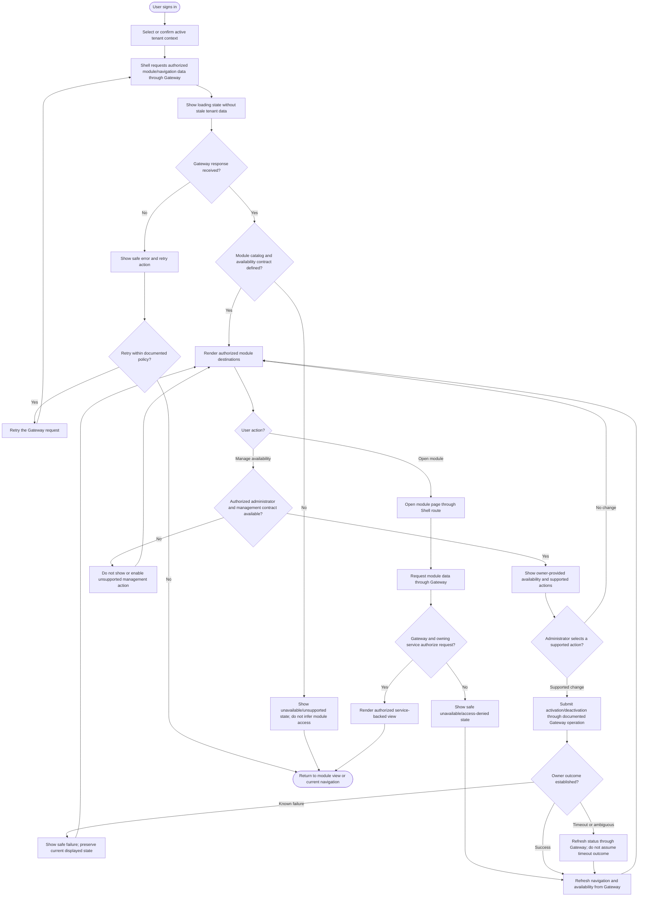

# Module Management UX Flow

## Purpose and status

This flow describes how a tenant user discovers and opens product modules in
the Control Panel Shell, and how an authorized administrator may manage
availability if that capability is later defined.

The Shell is presentation-only. It renders navigation and views from
documented API Gateway responses; it does not own the module catalog,
tenant-module assignments, activation lifecycle, or authorization decisions.
Current `/docs` do not assign an owner for the module catalog or tenant
availability and do not define module-management routes, DTOs, or lifecycle
states. Consequently, discovery and management actions below are conditional
on approved Gateway and owner contracts. The flow does not imply these
screens or operations are already implemented.

## UX flow

The “catalog contract defined?” and “management contract available?” gates
are intentional. Until those decisions are made, the Shell must not invent
a module catalog, tenant-availability route, or activation control.

## Screen and interaction states

If module discovery is exposed by an approved Gateway contract, the Shell
should support these states:

- **Loading:** communicate that module/navigation data is being requested.
  Do not continue showing tenant-sensitive content from a prior tenant while
  the active tenant changes.
- **Loaded:** show only destinations returned for the authorized context.
  Use the established navigation labels and keep the active tenant context
  visible.
- **Empty or unavailable:** show an understandable empty/unavailable state
  when the documented response says no modules are available. Do not infer
  that an empty or failed response means the tenant should be activated.
- **Error:** show a safe message and retry affordance. Follow bounded retry
  behavior; do not expose internal routes, service names, or error details.
- **Access denied:** explain that the view is unavailable without revealing
  whether another tenant's module or resource exists. A hidden menu item is
  not the authorization boundary.
- **Stale or changed context:** refresh through the Gateway when identity or
  tenant context changes. Do not use client-side availability state to
  authorize a request.

For module availability management, render actions only when an approved
owner contract identifies the actor permissions, operations, responses, and
supported lifecycle transitions. Confirm potentially consequential
activation, deactivation, or removal actions using impact information
defined by that contract. Do not claim that deactivation deletes domain
data, cancels work, or changes billing unless those consequences are
explicitly documented.

## Authorization and tenant behavior

- The Shell calls the API Gateway only; it does not call private services,
  read PostgreSQL, or subscribe to domain events.
- The Gateway validates the Auth-issued JWT and establishes trusted tenant
  context. A tenant identifier supplied by a browser control is not proof
  of access.
- Auth roles and permissions determine what the user may do. The service
  that owns the requested resource independently enforces tenant and
  resource authorization on every API request.
- Module availability is not an authorization grant. A visible navigation
  item, module assignment, role claim, or valid JWT alone does not grant
  access to all data in that module.
- Feature toggles, module settings, and billing entitlements remain distinct
  from module availability. Do not infer availability from a plan, payment,
  invoice, subscription, toggle, or settings value without an approved
  contract.
- After a tenant switch, clear or isolate tenant-sensitive client state and
  refresh data through the Gateway. Do not render stale views from the
  previous tenant.

## Accessibility and navigation behavior

- Use semantic navigation landmarks and links for module destinations;
  use buttons for management actions.
- Expose the active route programmatically, such as with `aria-current`.
  Support keyboard navigation, visible focus, and responsive navigation
  behavior from the Shell navigation guidance.
- Present loading, empty, error, and completion feedback in a way assistive
  technology can perceive. Do not rely on color or icon alone to show
  availability or errors.
- Keep module labels consistent with the product navigation. Do not expose
  internal service names, schema names, or private API routes in user-facing
  text or URLs.
- Preserve the current page and focus context after refresh or management
  actions when safe; after access is revoked, move to an authorized,
  understandable destination.

## Failure and recovery

- A failed module-list request is not an empty catalog and is not evidence
  that a module is disabled.
- A timeout on an activation/deactivation request is ambiguous. Refresh
  status through the Gateway or follow the owner-defined reconciliation
  flow before offering another state-changing attempt.
- Retry only classified transient failures within the documented retry
  policy. Do not repeat non-idempotent actions without an owner-defined
  idempotency contract.
- Display pending, partial, or completed status only when the owner API
  contract defines those states. Do not present a success confirmation
  before the owner establishes the outcome.
- Use the canonical Gateway response envelope and `correlationId` for
  diagnostics. User-facing messages must not expose tokens, SQL, internal
  hostnames, secrets, or cross-tenant resource existence.

## Decisions required before implementation

1. Assign ownership and a source of truth for the catalog and tenant module
   availability.
2. Define Gateway discovery and management routes, response DTOs, errors,
   versioning, and the module keys/navigation metadata the Shell may render.
3. Define administrator permissions and supported activation,
   deactivation, removal, and lifecycle consequences.
4. Specify how tenant context is established and how each domain service
   enforces module availability alongside Auth and resource authorization.
5. Decide how the Shell refreshes availability, handles caching,
   invalidation, asynchronous outcomes, and tenant changes.
6. Define any billing-entitlement dependency explicitly; do not infer
   plan-based access.
7. Specify accessibility, responsive behavior, pending/error feedback, and
   safe recovery states for each supported management operation.