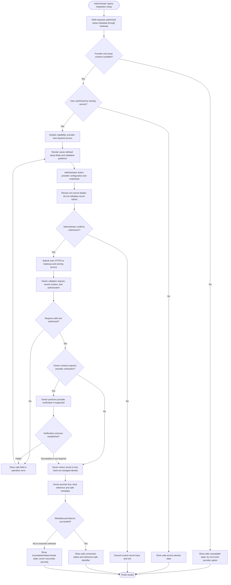

# Integration Setup Wizard UX Flow

## Purpose and status

The wizard helps an authorized tenant administrator configure a connection
between an external provider and a Daedalus capability. The service that
owns the capability also owns the connection, provider behavior, and
connection metadata. There is no standalone Integration Service or shared
integration schema in the current architecture.

The current `/docs` do not define a provider catalog owner, generic
integration route, wizard screens, provider-specific credential fields,
verification requirements, connection-state enumeration, or setup DTOs.
This document defines UX constraints and a conditional flow; it does not
establish a universal wizard contract. Exact steps and fields must come
from the owning service's approved Gateway contract.

## User flow

Provider verification and field retry behavior are conditional on the
owning contract. The flow does not imply that every provider supports a test
connection, that verification precedes secret storage for all providers, or
that a failed verification has one universal recovery action.

## Wizard steps and interaction guidance

1. **Find a supported setup.** Show only providers and capabilities made
   available through an approved Gateway contract. If provider discovery is
   not defined, do not hard-code an assumed shared catalog or route.
2. **Explain the connection.** Identify the capability-owning service in
   user-facing terms, why the connection is needed, and the permissions or
   provider access required where the owner documents them.
3. **Collect owner-defined input.** Render only the fields and validation
   requirements in that integration's request DTO. Do not invent credential
   formats, scopes, OAuth steps, callback URLs, or permissions.
4. **Review and confirm.** Let the administrator review safe, non-secret
   values and confirm submission. Never echo a credential or token in the
   review screen, browser URL, browser storage, or diagnostic output.
5. **Submit once to the owner.** The Shell sends the request to the API
   Gateway over HTTPS. The Gateway routes it to the capability-owning
   service, which independently validates and authorizes it.
6. **Show progress or outcome.** Present only status and a
   reference-safe identifier returned by the owning API. If setup is
   asynchronous, display only documented operation states and refresh
   through the Gateway.
7. **Finish or recover.** On confirmed completion, show the safe connected
   status. On validation failure, preserve only safe user input and
   associate field errors with documented fields. On timeout or indeterminate
   outcome, show a pending/reconciliation state if the contract supports it;
   do not invite a duplicate submission unless retry is safe.

## Credential and security requirements

- The Shell never calls the provider, private service, database, or Key
  Vault directly. It submits credentials only through the owning
  integration API behind the Gateway.
- The owning service establishes trusted tenant context and authorizes the
  connection operation. A browser-provided `tenantId`, visible setup page,
  role claim, module assignment, or valid JWT alone is not sufficient
  authorization.
- The owning backend stores credential values in Azure Key Vault using its
  managed identity and least-privilege permissions. PostgreSQL stores only
  a Key Vault reference and approved non-secret provider metadata in the
  owning service's schema.
- Never persist secret values in browser state, local storage, URLs,
  PostgreSQL, API responses, events, logs, screenshots, telemetry, or
  source control. Clear secret-form values when leaving the flow, after
  submission, or when the active tenant changes.
- Responses and error messages may include safe connection status and a
  reference-safe identifier only. Do not expose secret values, raw provider
  payloads, SQL, internal hostnames, tokens, or another tenant's resource
  existence.
- Tenant-scoped persistence uses `tenant_id`; API/event contracts use
  `tenantId`. Provider credentials must not be shared across tenants or
  services without an explicitly reviewed contract.

## Validation, errors, and recovery UX

- **Invalid input:** show only owning-service validation messages that are
  safe and tied to documented fields. Do not reveal provider internals.
- **Unauthorized or wrong tenant:** show a safe denial and do not indicate
  whether another tenant has a connection.
- **Provider verification failure:** display the safe error/status defined
  by the owner; do not imply that credentials were stored or discarded
  unless the owner confirms the outcome.
- **Key Vault or metadata failure:** show an incomplete or indeterminate
  state if defined. A secret may have been stored even if reference
  persistence failed; the UI must not claim rollback or delete it itself.
  The owner defines cleanup, reconciliation, and retry behavior.
- **Timeout or lost response:** treat the result as ambiguous. Refresh
  connection status through the Gateway or follow the owner's documented
  reconciliation flow before offering another submit action.
- **Retry:** use bounded retry behavior and idempotency only when the
  operation contract makes it safe. Do not automatically repeat an
  external side effect.
- **Exit/cancel:** discard unsent secrets from transient UI state. Once a
  request has been submitted, cancellation or disconnect is a separate
  owner-controlled operation, not a local form action.

Errors use the canonical Gateway response envelope and include a
`correlationId`. User-facing messages must not expose credentials, tokens,
SQL, internal implementation details, or sensitive provider data.

## Accessibility and usability

- Implement the flow as a semantic form with a clear title, step context,
  and programmatic labels for every field.
- Identify required fields and validation errors in text; associate errors
  with their inputs and move focus to the error summary or first invalid
  field after submission.
- Provide keyboard operation, visible focus, announced progress/status,
  and an accessible confirmation step. Do not use color or icons alone for
  errors or connection state.
- Preserve safe non-secret form input across validation corrections where
  appropriate, but never retain credentials beyond the necessary transient
  submission state.
- On narrow screens and zoom, keep form controls and primary actions
  reachable without horizontal scrolling.

## Decisions required before implementation

For each provider setup wizard, document:

1. The capability-owning service, provider discovery source, Gateway route,
   request/response DTOs, and authorized actors.
2. Provider-specific fields, validation, credential format, verification
   behavior, and any consent/disclosure text.
3. Key Vault naming/reference policy, managed identity permissions, and
   secure secret-input handling.
4. Safe connection states, progress/status refresh, error mapping, and
   reference-safe identifiers.
5. Timeout, idempotency, retry, ambiguous-outcome reconciliation, cleanup,
   rotation, and disconnect behavior.
6. Tenant/resource authorization, audit fields, correlation propagation,
   retention, redaction, and operational recovery.
7. Accessibility requirements and UX behavior for pending, failed,
   unverified, or indeterminate results.

Until these contracts are defined, keep the setup flow provider-specific
and do not introduce a generic integration endpoint, central integration
catalog, or standalone Integration Service.