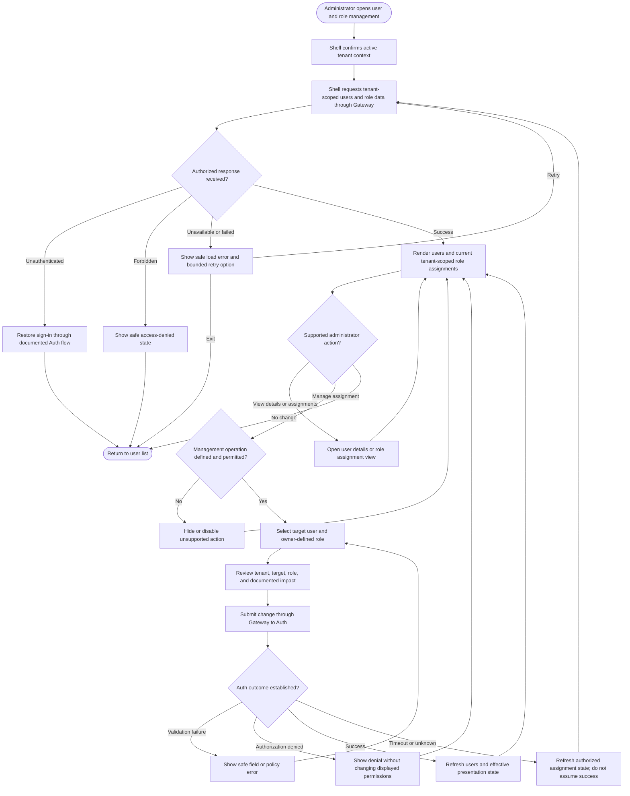

# User and Role Management UX Flow

## Purpose and status

This flow describes how an authorized tenant administrator may review users
and manage tenant-scoped role assignments in the Control Panel. Auth is the
authoritative service for identity, tenant memberships, roles, and
permissions. The Shell presents the documented operations through the API
Gateway; it does not create authorization policy or make final access
decisions.

The current `/docs` do not define user-management routes, invitation or
account-provisioning flows, role catalogs, assignable-role rules, role
assignment DTOs, or membership lifecycle states. The flow below is therefore
conditional on an approved Auth/Gateway contract. It does not imply a
particular administrator role name, permission hierarchy, or set of
available actions.

## UX flow

The diagram illustrates a role-assignment change only when the owning Auth
contract supports it. Invitation, user creation, role creation, membership
removal, and tenant transfer must not be presented as available actions
unless separately defined and authorized.

## Screen and interaction guidance

1. **Establish context.** Show the active tenant clearly and load management
   data for that trusted context through the Gateway. Clear or isolate
   tenant-sensitive content when the active context changes.
2. **Load authorized data.** Render only user and assignment information
   returned by the authorized API response. Provide loading, empty, and
   recoverable error states without treating a failed response as an empty
   tenant.
3. **Choose a target.** If the contract exposes tenant members, allow the
   administrator to select only from that tenant-scoped result. Do not
   discover or reveal whether an identity belongs to another tenant.
4. **Choose a permitted change.** Offer only roles and operations that the
   Auth contract says the current administrator may assign. Do not assume
   role names, role hierarchy, permission contents, or that every role is
   assignable.
5. **Confirm consequential changes.** Before submission, summarize the
   target, tenant, requested role change, and any impact explicitly supplied
   by the contract. Do not claim that a role grants or removes specific
   abilities unless those permissions are documented.
6. **Submit and refresh.** Send the operation once through the Gateway.
   Refresh the assignment from the authoritative response or a documented
   read operation rather than treating local UI state as the new authority.
7. **Handle uncertain outcomes safely.** On timeout or lost response, reload
   the assignment through the Gateway before offering another change. Retry
   only when the operation is documented as safe or idempotent.

## Authorization and tenant boundaries

- The Shell calls the API Gateway only. It does not call Auth's private
  service, access identity tables, or enforce role policy itself.
- Auth owns identity, tenant membership, roles, and permissions. The Gateway
  validates the JWT and propagates trusted identity and tenant context;
  downstream services still enforce tenant and resource authorization for
  their own data.
- The current tenant must come from the supported Auth/Gateway context, not
  from a browser-supplied `tenantId`. A user-selected tenant is not proof of
  membership or authority.
- A valid JWT, a role claim displayed by the Shell, or a visible management
  control is not sufficient authorization. Auth and the relevant service
  make the authoritative decision for each operation.
- Role and permission management is distinct from module availability,
  feature toggles, billing entitlements, and module settings. Do not infer
  one from another.
- Do not expose membership or role information across tenant boundaries.
  Avoid responses or user-facing errors that reveal another tenant's users
  or resources.

## Errors, recovery, and audit

- **Unauthenticated:** follow the documented sign-in recovery path; do not
  repeatedly retry with an expired or invalid token.
- **Forbidden:** show an access-denied state, not a sign-in prompt. Keep
  authorization denied even if the Shell previously displayed a control.
- **Validation or policy failure:** show safe, documented messages and
  associate field errors with the relevant controls. Do not expose policy
  internals or sensitive identity details.
- **Unavailable service:** show a recoverable error with a bounded retry
  action. Do not treat a timeout as a successful role change.
- **Ambiguous result:** reload the assignment through the Gateway and render
  the authoritative state. Do not automatically replay a potentially
  non-idempotent administrative operation.
- **Audit:** Auth or the responsible backend component records role and
  permission changes and administrative identity changes with actor,
  tenant, target, decision, and `correlationId` where applicable. The Shell
  may use the correlation ID as a support reference but must not log tokens,
  credentials, or unnecessary sensitive identity data.

## Accessibility

- Use semantic headings, a labeled user list or table, and properly labeled
  form controls. Communicate the active tenant in text.
- Identify role choices and their documented descriptions in text; do not
  rely on color or icons to convey access or status.
- Associate validation messages with controls and move focus to an error
  summary or the first invalid field after submission.
- Announce loading, completion, and failure status to assistive technology.
  Preserve keyboard navigation and visible focus through confirmation and
  recovery states.

## Decisions required before implementation

The Auth/Gateway contract must define:

1. Which tenant-scoped user and assignment data may be read, by which actors,
   and through which routes and DTOs.
2. Whether the scope includes invitations, account provisioning, membership
   changes, role assignment, role creation, or only viewing assignments.
3. The role catalog, permission descriptions, assignable-role rules, and
   any restrictions on changing one's own assignment or the last
   administrator.
4. How tenant context and membership are established and revalidated for
   reads and changes.
5. Confirmation, validation, concurrency, idempotency, and ambiguous-outcome
   behavior for administrative changes.
6. Safe response fields, status/error mappings, audit fields, correlation
   propagation, and retention/redaction requirements.

Until these decisions are documented, keep the Shell limited to
authorization-aware presentation of supported Auth responses and do not
invent user-management routes, role names, permission rules, or lifecycle
behavior.